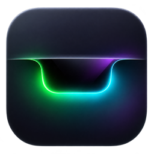
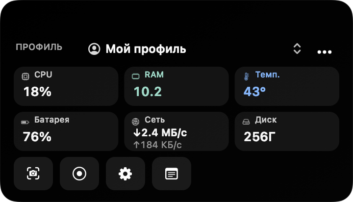
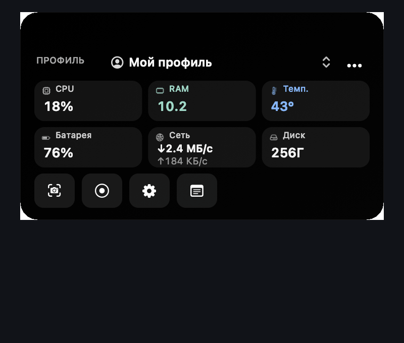
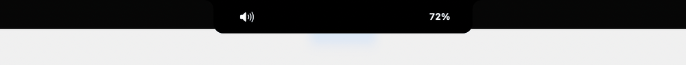
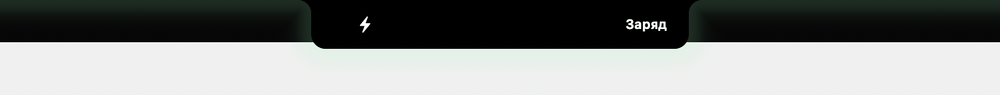
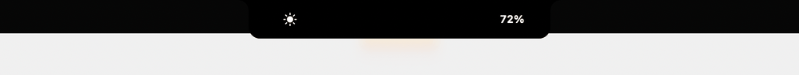
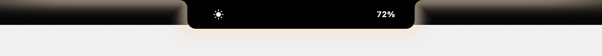
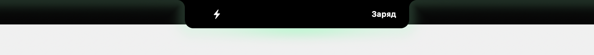
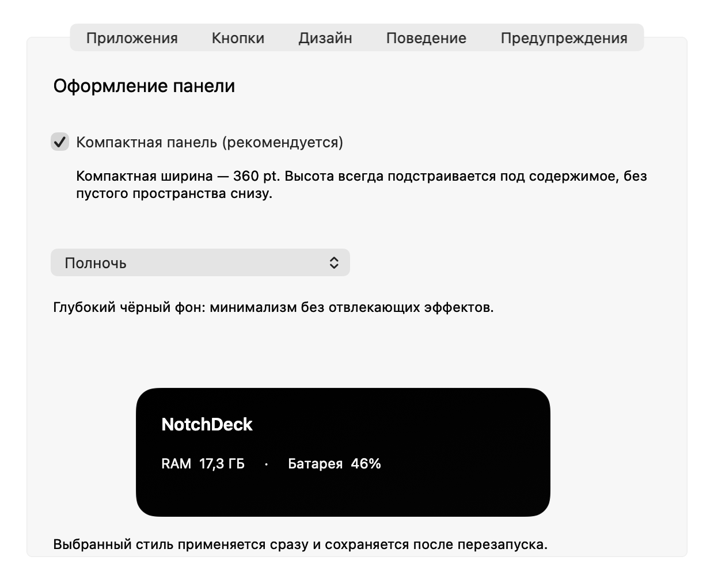
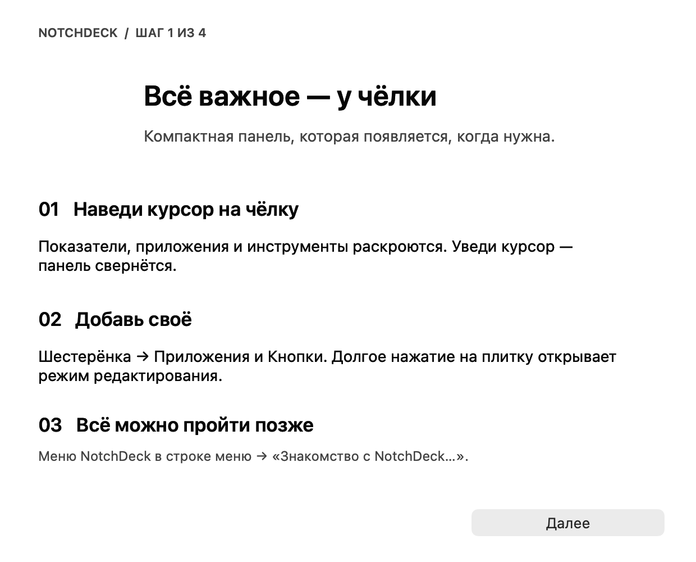

<p align="center"></p>
<h1 align="center">NotchDeck</h1>
<p align="center">A compact control center around your MacBook notch.</p>

**Apple Silicon · macOS 26+ · MIT · Preview 2.0.0**

[Download DMG](https://github.com/systemAdmin-ai/NotchDeck/releases/download/v2.0.0-preview.1/NotchDeck-2.0.0-AppleSilicon.dmg) · [Русский](README.md)

Hover over the notch for system metrics, app shortcuts, quick notes and screen
recording. Features include task profiles, eight themes, brightness/volume glow, charging animation,
configurable alerts and a compact now-playing view. The interface and onboarding
are currently in Russian.

Version 2 adds profile duplication/renaming, independent app and button layouts, light/dark/automatic materials, a subtle low-battery pulse, and backdrop-aware neon when screen permission is available. Auto material follows the macOS theme; halo adaptation samples only a narrow strip in memory.

## Install

Download the Apple Silicon DMG, open it, and drag NotchDeck into Applications.
Launch it from Applications and complete the four-step onboarding.

This preview is ad-hoc signed, **not Developer ID signed or Apple notarized**.
macOS may block the first launch. Use the standard Privacy & Security flow only
if you choose to trust the app; see [Apple's guidance](https://support.apple.com/en-us/102445).
Do not disable Gatekeeper or SIP. Permission refresh may be needed after updates.

## Screenshots

These are **version 2.0 component renders with synthetic demo data**. They contain no personal app shortcuts, VPN status or user preferences.









Brightness and volume indicators replace the system HUD after permission is granted.
Charging and alerts have their own glow. Close-ups and the brightness animation:



| Brightness | Volume |
|---|---|
|  |  |
| **Memory alert** | **Charging pulse** |
|  |  |

<details>
<summary>Settings → Design — complete window</summary>



</details>

<details>
<summary>First launch — complete window</summary>



</details>

## Use

- Hover over the notch, or use the menu-bar icon, to open the panel.
- Use Settings to add your own apps, choose buttons and select a theme.
- Press Record to choose full screen / region, microphone and system audio.
  A red stop button shows elapsed time. Recordings go to `~/Desktop/Screenshots`.
- Clipboard history is opt-in, memory-only, and cleared on exit. Login launch is opt-in.
- Run the quick demo from the menu. Repeat onboarding from the same menu.

No personal presets, notes, logs or recordings ship. No telemetry or cloud sync.
[Privacy details](PRIVACY.md). Some media features use a private macOS API and may
change after OS updates. Tested on macOS 27 with Apple Silicon; Intel is unsupported.

## Build

Install Xcode Command Line Tools with macOS 26+ SDK, clone the repository, and run:

```bash
./build.sh
./scripts/check.sh
./scripts/package.sh
```

The app is in `Build`, packages in `Dist`. Dependencies are included as source.
Code is MIT; [third-party licenses](THIRD_PARTY_NOTICES.md) are preserved.
