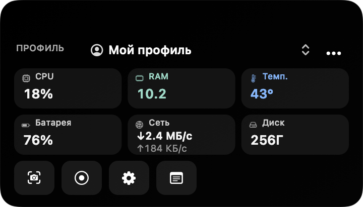
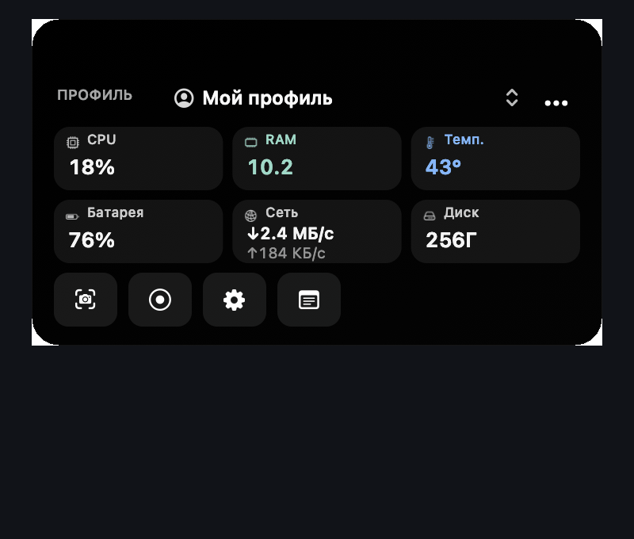
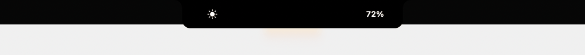
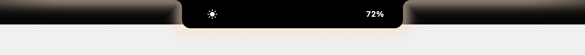
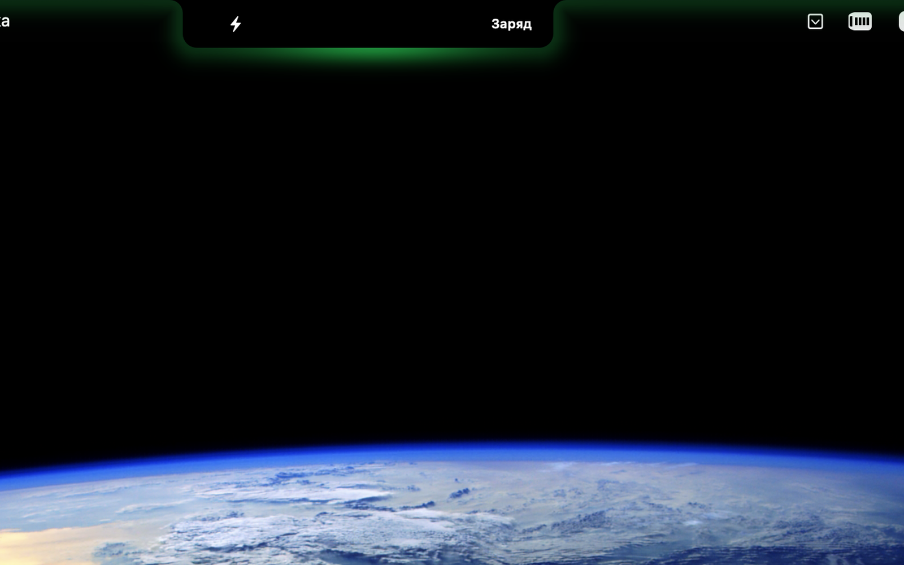

<p align="center">
  <a href="https://systemAdmin-ai.github.io/NotchDeck/">
    
  </a>
</p>

<p align="center">
  
  
  
  
  <a href="https://github.com/systemAdmin-ai/NotchDeck/actions/workflows/build.yml"></a>
</p>

<p align="center">
  <a href="https://github.com/systemAdmin-ai/NotchDeck/releases/latest/download/NotchDeck.dmg"></a>
  <a href="https://systemAdmin-ai.github.io/NotchDeck/"></a>
  <a href="https://systemAdmin-ai.github.io/NotchDeck/demo.html"></a>
  <a href="README.ru.md"></a>
</p>


Hover over the notch for system metrics, app shortcuts, quick notes and screen
recording. Features include task profiles, eight themes, brightness/volume glow, charging animation,
configurable alerts and a compact now-playing view. The interface is available in
English and Russian: choose the language on the first onboarding screen or in
**Settings → General**; the change applies immediately, without relaunching.

Version 2 adds profile duplication/renaming, independent app and button layouts, light/dark/automatic materials, a subtle low-battery pulse, and backdrop-aware neon when screen permission is available. Auto material follows the macOS theme; halo adaptation samples only a narrow strip in memory.

## Keyboard mode (2.1 development preview)

The keyboard button toggles Alt+Shift language switching and maps left Ctrl to Command on external USB/Bluetooth keyboards. Automatic mode enables it when an external keyboard connects. Manual off persists across reconnects and restarts. Green indicates a verified active mapping; amber indicates an exception or a setup conflict.

Open **Settings → Windows keyboard** for automatic mode and Input Monitoring permission. Close standalone DeskBridge before enabling this mode. The built-in keyboard and right Ctrl retain their normal behavior; terminals and remote sessions are excluded from Ctrl replacement. This feature is available in the development build, not the linked release, which predates it. See the [specification](docs/specs/KEYBOARD-MODE.md).

## Install

Requires an Apple Silicon Mac (M1 or newer) and macOS 14 or newer. Intel is unsupported.

### One command (recommended)

```bash
curl -fsSL https://raw.githubusercontent.com/systemAdmin-ai/NotchDeck/main/scripts/install.sh | bash
```

The script downloads the latest release archive, verifies its SHA256 against the published
`SHA256SUMS.txt`, unpacks it into `/Applications` and launches the app. There is no
"app can't be checked" dialog: the file is fetched with curl rather than a browser, so it
carries no quarantine flag. Gatekeeper and SIP stay enabled.

### Homebrew

```bash
brew install --cask systemAdmin-ai/notchdeck/notchdeck
```

Update with `brew upgrade --cask notchdeck`, remove with `brew uninstall --cask notchdeck`.
The cask downloads the DMG, so it needs the quarantine flag cleared:

```bash
brew install --cask --no-quarantine systemAdmin-ai/notchdeck/notchdeck
```

### DMG, manually

1. Open the [latest release](https://github.com/systemAdmin-ai/NotchDeck/releases/latest)
   and download `NotchDeck-<version>-AppleSilicon.dmg`.
2. Open the DMG and drag **NotchDeck.app** into **Applications**.
3. Launch it from Applications.

The app is signed with a local certificate — no Developer ID, not Apple-notarized — so the
first launch may be blocked. If macOS shows the "cannot be checked" dialog, open
**System Settings → Privacy & Security**, find the NotchDeck entry and click
**Open Anyway**. That is Apple's own flow: [guidance](https://support.apple.com/en-us/102445).
Do not disable Gatekeeper or SIP, and do not strip the quarantine flag by hand — the person
running the app decides whether to trust it, not a script.

### After installing

- Finish the short onboarding: interface language, then the offered permissions.
  Permissions are optional — the panel and metrics work immediately; without them only the
  brightness/volume HUD replacement, screenshots, recording and voice stay silent.
  See [first launch and permissions](docs/GETTING_STARTED.md).
- Update by re-running the install command or with `brew upgrade --cask notchdeck`.
  Settings and permissions survive.
- Remove by dragging the app to the Trash; clear preferences with
  `defaults delete com.notchdeck.app` if you want them gone too.

### Building it yourself

Create the local signing certificate first, otherwise the build is ad-hoc signed and macOS
drops the Accessibility permission after the first rebuild:

```bash
./scripts/setup-signing.sh
./build.sh
```

The same mechanism as a standalone repository usable in any project:
[systemAdmin-ai/macos-local-codesign](https://github.com/systemAdmin-ai/macos-local-codesign).

## Where to download

NotchDeck comes from exactly three places:

- **Releases** — https://github.com/systemAdmin-ai/NotchDeck/releases
- **Homebrew** — `brew install --cask systemAdmin-ai/notchdeck/notchdeck`
- **This site** — https://systemAdmin-ai.github.io/NotchDeck/

There is no paid, "activated" or "cracked" version: the app is free and MIT-licensed, so
a crack has nothing to break. If another site offers NotchDeck, it is a repack, and we
cannot vouch for what was added to it.

Every release ships `SHA256SUMS.txt`. Check the file you downloaded before opening it:

```sh
shasum -a 256 -c SHA256SUMS.txt
```

A mismatch means the file was modified. Tell us instead of running it — see
[SECURITY.md](SECURITY.md).

## Screenshots

These are **version 2.0 component renders with synthetic demo data**. They contain no personal app shortcuts, VPN status or user preferences.






Brightness and volume indicators replace the system HUD after permission is granted.
Charging and alerts have their own glow. Close-ups and the brightness animation:



| Brightness | Volume |
|---|---|
|  |  |
| **Memory alert** | **Charging pulse** |
|  |  |

<details>
<summary>Settings → Design — complete window</summary>


</details>

<details>
<summary>First launch — complete window</summary>


</details>

## Use

- Hover over the notch, or use the menu-bar icon, to open the panel.
- Use Settings to add your own apps, choose buttons and select a theme.
- Press Record to choose full screen / region, microphone and system audio.
  A red stop button shows elapsed time. Recordings and screenshots go to the folder
  chosen in Settings → Capture (`~/Desktop/Screenshots` by default).
- Clipboard history is opt-in, memory-only, and cleared on exit. Login launch is opt-in.
- Run the quick demo from the menu. Repeat onboarding from the same menu.

No personal presets, notes, logs or recordings ship. No telemetry or cloud sync.
[Privacy details](PRIVACY.md). Some media features use a private macOS API and may
change after OS updates. Tested on macOS 27 with Apple Silicon; the bundle targets macOS 14 or newer. Intel is unsupported.

See [first launch and permissions](docs/GETTING_STARTED.md).

## Build

Install Xcode Command Line Tools with macOS 26+ SDK (the app itself targets macOS 14), clone the repository, and run:

```bash
./build.sh
./scripts/check.sh
./scripts/package.sh
```

The app is in `Build`, packages in `Dist`. Dependencies are included as source.

Create the local signing certificate once (`./scripts/setup-signing.sh`) — see
[Building it yourself](#building-it-yourself) above for why and what it does.
Code is MIT; [third-party licenses](THIRD_PARTY_NOTICES.md) are preserved.
