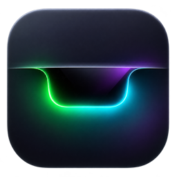
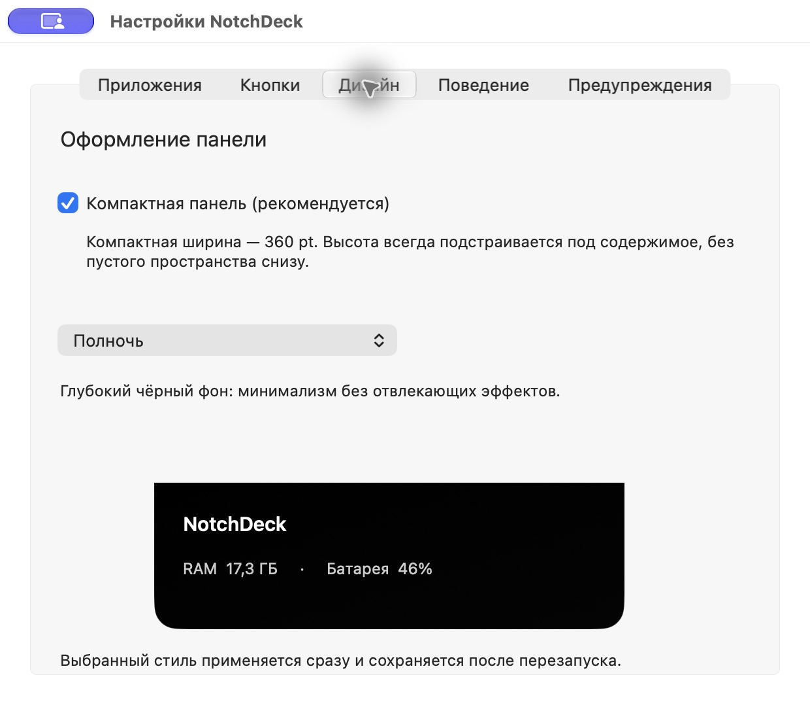
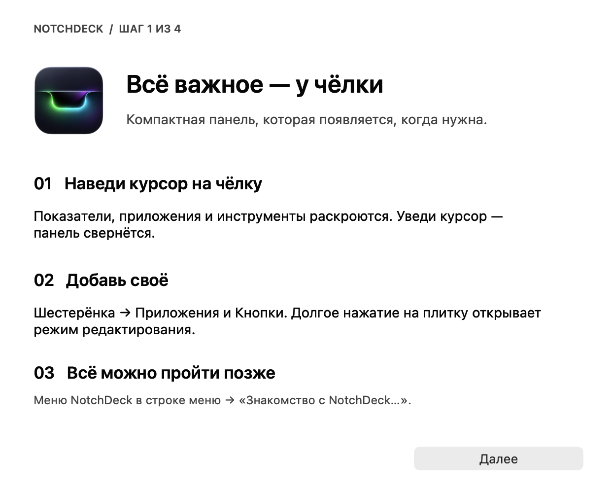

<p align="center"></p>
<h1 align="center">NotchDeck</h1>
<p align="center">Чёлка MacBook как компактный центр управления.</p>
<p align="center"><b>macOS 26+ · Apple Silicon · Бесплатно · MIT</b></p>
<p align="center"><a href="https://github.com/systemAdmin-ai/NotchDeck/releases/download/v0.1.0-preview.1/NotchDeck-0.1.0-AppleSilicon.dmg">Скачать DMG</a> · <a href="docs/GETTING_STARTED.md">Начало работы</a> · <a href="PRIVACY.md">Конфиденциальность</a> · <a href="README.EN.md">English</a></p>

> **Preview 0.1.0.** Приложение ещё развивается. Сборка проверена на macOS 27,
> Apple Silicon. Intel и версии macOS ниже 26 не поддерживаются этим релизом.
> Developer ID и нотариализации Apple пока нет — это явно отмечено в инструкции установки.

## Установка

1. Открой [Releases](https://github.com/systemAdmin-ai/NotchDeck/releases) и скачай `NotchDeck-0.1.0-AppleSilicon.dmg`.
2. Открой DMG и перетащи **NotchDeck.app** в **Applications / Программы**.
3. Запускай приложение из Applications. Пройди короткое знакомство.
4. При необходимости выдай разрешения, описанные в онбординге. Они не нужны для обычного отображения панели.

**Важно о подписи.** Preview подписана локальной ad-hoc подписью, без Developer ID
и нотариализации. macOS может заблокировать первый запуск. Решение о запуске
принимает сам пользователь через «Конфиденциальность и безопасность»;
[официальная инструкция Apple](https://support.apple.com/en-us/102445).
Не нужно отключать Gatekeeper, SIP или выполнять команды удаления карантина.
После обновления такой сборки macOS может попросить повторно выдать доступ приложению.

## Что умеет

- Раскрывает компактную панель при наведении на чёлку и сворачивает при уходе курсора.
- Показывает RAM, батарею, CPU, сеть с КБ/с и МБ/с и другие выбираемые показатели.
- Заменяет индикатор яркости и громкости мягким неоновым свечением после выдачи доступа к клавишам.
- Показывает зелёный пробегающий импульс при подключении питания и красные предупреждения по настраиваемым порогам.
- Открывает компактный плеер при воспроизведении. Обложки зависят от поддержки приложения-плеера.
- Записывает экран с выбором области, микрофона и системного звука; на красной кнопке виден таймер.
- Хранит быстрые заметки локально, запускает выбранные пользователем приложения.
- Предлагает пять оформлений: Стекло, Графит, Полночь, Сияние и Неон.
- Объясняет первый запуск в четырёх шагах. История буфера и автозапуск выключены до выбора пользователя.

## Скриншоты

Панель в оформлении «Полночь». Ниже — **пример настроенной панели**: приложения
и набор показателей пользователь выбирает сам. Чистая установка начинает с базовой панели.


Индикаторы яркости и громкости заменяют системный HUD после выдачи доступа.
Подключение питания и предупреждения показываются отдельным свечением.
Ниже — крупные планы индикаторов и анимация яркости:


| Индикатор яркости | Индикатор громкости |
|---|---|
|  |  |
| **Предупреждение о памяти** | **Импульс при подключении питания** |
|  |  |

<details>
<summary>Настройки → Дизайн — окно целиком</summary>



</details>

<details>
<summary>Первый запуск — окно целиком</summary>



</details>

## Как пользоваться

| Действие | Что сделать |
|---|---|
| Открыть панель | Навести курсор на чёлку; запасной путь — значок NotchDeck в строке меню |
| Добавить приложение | Шестерёнка → Приложения → Добавить приложение |
| Изменить кнопки и дизайн | Шестерёнка → Кнопки / Дизайн |
| Быстро отредактировать | Долгое нажатие на плитку → скрыть / вернуть → Готово |
| Записать экран | Запись → выбрать звук и область → Начать; красная кнопка с таймером останавливает |
| Найти запись | Рабочий стол → Screenshots |
| Проверить анимации | Меню NotchDeck → Быстрый тест чёлки; тест зарядки — Настройки → Поведение |
| Повторить онбординг | Меню NotchDeck → Знакомство с NotchDeck |

Подробнее: [первый запуск и разрешения](docs/GETTING_STARTED.md).

## Сборка из исходников

Нужны Mac с Apple Silicon, macOS 26+ и Xcode Command Line Tools с SDK macOS 26+.

```bash
git clone https://github.com/systemAdmin-ai/NotchDeck.git
cd NotchDeck
./build.sh
open Build/NotchDeck.app
```

Для установки скопируй приложение из `Build` в `Applications`.
Необходимая сторонняя библиотека включена исходниками; зависимости не скачиваются во время сборки.

```bash
./scripts/check.sh       # Проверки модели, клавиш и HUD
./scripts/package.sh     # DMG, ZIP приложения и SHA256SUMS в Dist
```

## Ограничения

Температура и управление яркостью могут зависеть от модели Mac. Метаданные
плееров и VPN-статусы зависят от установленных приложений. Для медиа используется
частный API macOS через mediaremote-adapter; поведение может измениться после
обновления ОС. Перенос чужих значков из строки меню не выполняется: NotchDeck
показывает собственные статусы, а системные значки пользователь настраивает в macOS.

## Участие и лицензия

[Сообщить об ошибке](https://github.com/systemAdmin-ai/NotchDeck/issues/new) — укажи
версию приложения, macOS и шаги воспроизведения. Удаляй личные данные со скриншотов.
PR приветствуются. Основной код — [MIT](LICENSE); сторонние компоненты —
[Third-party notices](THIRD_PARTY_NOTICES.md).
