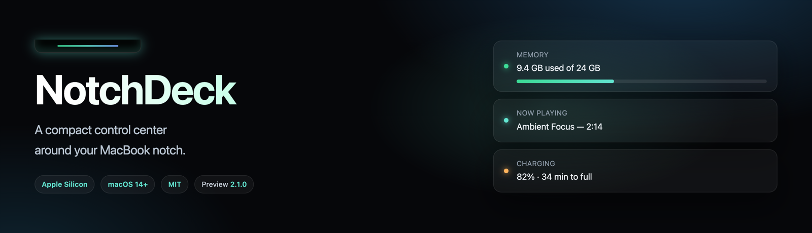
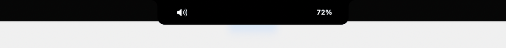
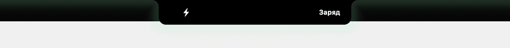
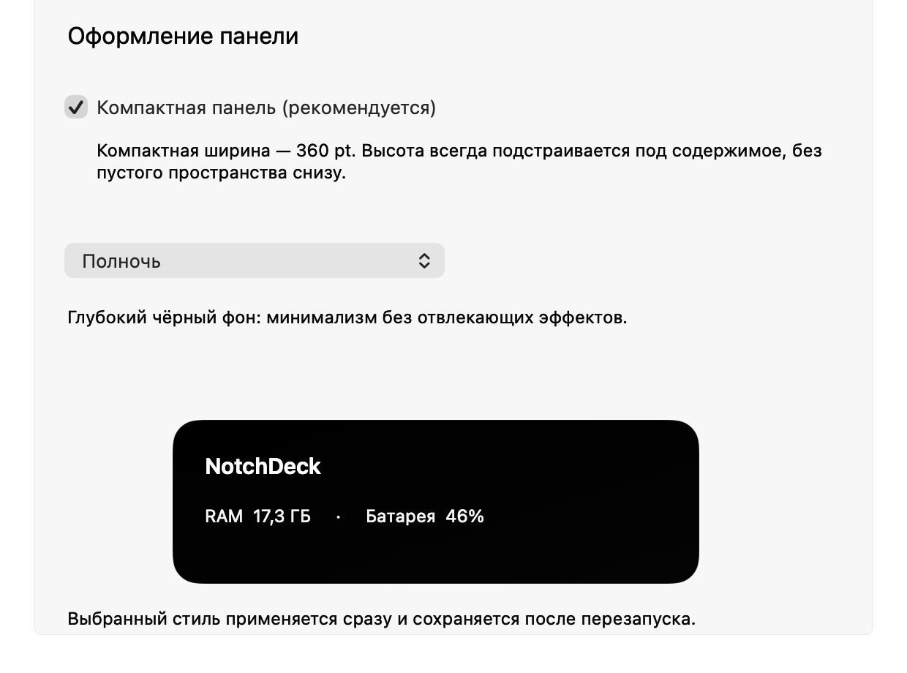

<p align="center">
  <a href="https://systemAdmin-ai.github.io/NotchDeck/">
    
  </a>
</p>

<p align="center">
  
  
  
  
  <a href="https://github.com/systemAdmin-ai/NotchDeck/actions/workflows/build.yml"></a>
</p>

<p align="center">
  <a href="https://github.com/systemAdmin-ai/NotchDeck/releases/latest/download/NotchDeck.dmg"></a>
  <a href="https://systemAdmin-ai.github.io/NotchDeck/"></a>
  <a href="https://systemAdmin-ai.github.io/NotchDeck/demo.html"></a>
  <a href="README.ru.md"></a>
</p>


Hover over the notch for system metrics, app shortcuts, quick notes and screen
recording. Features include task profiles, eight themes, brightness/volume glow, charging animation,
configurable alerts and a compact now-playing view. The interface is available in
English and Russian: choose the language on the first onboarding screen or in
**Settings → General**; the change applies immediately, without relaunching.

Version 2 adds profile duplication/renaming, independent app and button layouts, light/dark/automatic materials, a subtle low-battery pulse, and backdrop-aware neon when screen permission is available. Auto material follows the macOS theme; halo adaptation samples only a narrow strip in memory.

## Keyboard mode (2.1 development preview)

The keyboard button toggles Alt+Shift language switching and maps left Ctrl to Command on external USB/Bluetooth keyboards. Automatic mode enables it when an external keyboard connects. Manual off persists across reconnects and restarts. Green indicates a verified active mapping; amber indicates an exception or a setup conflict.

Open **Settings → Windows keyboard** for automatic mode and Input Monitoring permission. Close standalone DeskBridge before enabling this mode. The built-in keyboard and right Ctrl retain their normal behavior; terminals and remote sessions are excluded from Ctrl replacement. This feature is available in the development build, not the linked 2.0.1 release, which predates it. See the [specification](docs/specs/KEYBOARD-MODE.md).

## Install

**One command** (recommended — skips the "app can't be checked" dialog):

```bash
curl -fsSL https://raw.githubusercontent.com/systemAdmin-ai/NotchDeck/main/scripts/install.sh | bash
```

The script downloads the archive, verifies its SHA256 against the published `SHA256SUMS.txt`, unpacks it into `/Applications` and launches the app.

**Or with Homebrew:**

```bash
brew install --cask systemAdmin-ai/notchdeck/notchdeck
```

The app is ad-hoc signed, so clear the quarantine flag once before the first launch
(or install with `--no-quarantine`). Updates come with `brew upgrade`:

```bash
xattr -dr com.apple.quarantine "/Applications/NotchDeck.app"
# or
brew install --cask --no-quarantine systemAdmin-ai/notchdeck/notchdeck
```

**Or manually with the DMG:**

Download the Apple Silicon DMG, open it, and drag NotchDeck into Applications.
Launch it from Applications and complete the four-step onboarding.

This preview is ad-hoc signed, **not Developer ID signed or Apple notarized**.
macOS may block the first launch. Use the standard Privacy & Security flow only
if you choose to trust the app; see [Apple's guidance](https://support.apple.com/en-us/102445).
Do not disable Gatekeeper or SIP. Permission refresh may be needed after updates.

## Screenshots

These are **version 2.0 component renders with synthetic demo data**. They contain no personal app shortcuts, VPN status or user preferences.






Brightness and volume indicators replace the system HUD after permission is granted.
Charging and alerts have their own glow. Close-ups and the brightness animation:


| Brightness | Volume |
|---|---|
|  |  |
| **Memory alert** | **Charging pulse** |
|  |  |

<details>
<summary>Settings → Design — complete window</summary>



</details>

<details>
<summary>First launch — complete window</summary>


</details>

## Use

- Hover over the notch, or use the menu-bar icon, to open the panel.
- Use Settings to add your own apps, choose buttons and select a theme.
- Press Record to choose full screen / region, microphone and system audio.
  A red stop button shows elapsed time. Recordings go to `~/Desktop/Screenshots`.
- Clipboard history is opt-in, memory-only, and cleared on exit. Login launch is opt-in.
- Run the quick demo from the menu. Repeat onboarding from the same menu.

No personal presets, notes, logs or recordings ship. No telemetry or cloud sync.
[Privacy details](PRIVACY.md). Some media features use a private macOS API and may
change after OS updates. Tested on macOS 27 with Apple Silicon; the bundle targets macOS 14 or newer. Intel is unsupported.

See [first launch and permissions](docs/GETTING_STARTED.md).

## Build

Install Xcode Command Line Tools with macOS 26+ SDK (the app itself targets macOS 14), clone the repository, and run:

```bash
./build.sh
./scripts/check.sh
./scripts/package.sh
```

The app is in `Build`, packages in `Dist`. Dependencies are included as source.
Code is MIT; [third-party licenses](THIRD_PARTY_NOTICES.md) are preserved.
