<p align="center">
  <a href="https://systemAdmin-ai.github.io/NotchDeck/">
    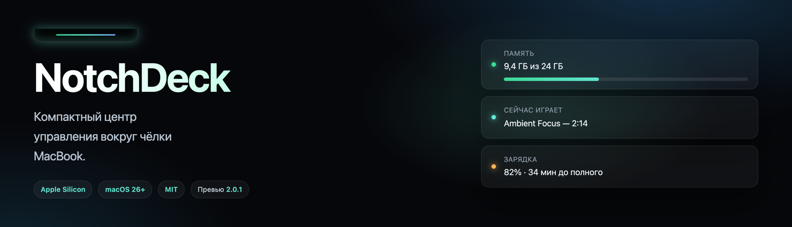
  </a>
</p>

<p align="center">
  
  
  
  
  <a href="https://github.com/systemAdmin-ai/NotchDeck/actions/workflows/build.yml"></a>
</p>

<p align="center">
  <a href="https://github.com/systemAdmin-ai/NotchDeck/releases/latest/download/NotchDeck.dmg"></a>
  <a href="https://systemAdmin-ai.github.io/NotchDeck/"></a>
  <a href="https://systemAdmin-ai.github.io/NotchDeck/demo.html"></a>
  <a href="README.md"></a>
</p>

> **Preview 2.1.1.** Приложение ещё развивается. Сборка проверена на macOS 27,
> Apple Silicon. Нужен macOS 14 или новее, Intel не поддерживается этим релизом.
> Developer ID и нотариализации Apple пока нет — это явно отмечено в инструкции установки.

## Режим клавиатуры (разрабатываемая версия 2.1)

Отдельная кнопка клавиатуры включает Alt+Shift и замену левого Ctrl на Command для внешних USB- и Bluetooth-клавиатур. Авторежим включает функцию при подключении клавиатуры. Ручное выключение сохраняется после переподключения и перезапуска. Зелёная подсветка означает подтверждённое переназначение; оранжевая — исключение или проблему настройки.

Откройте **Настройки → Клавиатура Windows**, чтобы настроить авторежим и разрешить мониторинг ввода. Перед включением закройте отдельный DeskBridge. Встроенная клавиатура и правый Ctrl сохраняют обычное поведение; терминалы и удалённые сессии исключены из замены Ctrl. Функция доступна в сборке разработки, но ещё не входит в опубликованный релиз 2.0.1 и появится в следующем. [Спецификация](docs/specs/KEYBOARD-MODE.md).

## Установка

Нужны Mac на Apple Silicon (M1 и новее) и macOS 14 или новее. Intel не поддерживается.

### Способ 1 — одной командой (рекомендуется)

```bash
curl -fsSL https://raw.githubusercontent.com/systemAdmin-ai/NotchDeck/main/scripts/install.sh | bash
```

Скрипт берёт архив последнего релиза, сверяет SHA256 с опубликованным `SHA256SUMS.txt`,
распаковывает в `/Applications` и запускает приложение. Окна «приложение не проверено»
не будет: файл скачан не браузером, поэтому метка карантина не ставится. Gatekeeper
и SIP не отключаются.

### Способ 2 — Homebrew

```bash
brew install --cask systemAdmin-ai/notchdeck/notchdeck
```

Обновление — `brew upgrade --cask notchdeck`, удаление — `brew uninstall --cask notchdeck`.
Каск скачивает DMG, поэтому карантин снимается флагом:

```bash
brew install --cask --no-quarantine systemAdmin-ai/notchdeck/notchdeck
```

### Способ 3 — DMG вручную

1. Открой [последний релиз](https://github.com/systemAdmin-ai/NotchDeck/releases/latest)
   и скачай `NotchDeck-<версия>-AppleSilicon.dmg`.
2. Открой DMG и перетащи **NotchDeck.app** в **Applications / Программы**.
3. Запусти приложение из Applications.

Приложение подписано локальным сертификатом, без Developer ID и без нотариализации Apple,
поэтому первый запуск macOS может заблокировать. Если появилось окно «не удаётся проверить
приложение», открой **Системные настройки → Конфиденциальность и безопасность**, найди
строку про NotchDeck и нажми **«Всё равно открыть»**. Это стандартный путь Apple:
[инструкция](https://support.apple.com/en-us/102445). Не отключай Gatekeeper и SIP
и не удаляй карантин вручную — решение о запуске принимает пользователь, а не скрипт.

### После установки

- Пройди короткое знакомство: язык интерфейса, затем предложение разрешений.
  Разрешения необязательны — панель и метрики работают сразу, без них молчат только
  замена индикаторов яркости/громкости, снимки, запись и голос.
  Что и зачем: [первый запуск и разрешения](docs/GETTING_STARTED.ru.md).
- Обновление: повтори команду установки (способ 1) или `brew upgrade --cask notchdeck`.
  Настройки и разрешения сохраняются.
- Удаление: перетащи приложение в Корзину; настройки при желании сотри командой
  `defaults delete com.notchdeck.app`.

### Если собираешь сам

Если собираешь сам, сначала создай локальный сертификат подписи — иначе сборка будет
ad-hoc и разрешение «Универсальный доступ» слетит после первой же пересборки:

```bash
./scripts/setup-signing.sh
./build.sh
```

Тот же механизм отдельным репозиторием, пригодным для любого проекта:
[systemAdmin-ai/macos-local-codesign](https://github.com/systemAdmin-ai/macos-local-codesign).

## Что умеет

- Раскрывает компактную панель при наведении на чёлку и сворачивает при уходе курсора.
- Интерфейс на русском и английском: язык выбирается на первом экране знакомства или в «Настройках → Общие» и применяется сразу.
- Показывает RAM, батарею, CPU, сеть с КБ/с и МБ/с и другие выбираемые показатели.
- Заменяет индикатор яркости и громкости мягким неоновым свечением после выдачи доступа к клавишам.
- Показывает зелёный пробегающий импульс при подключении питания и красные предупреждения по настраиваемым порогам.
- Открывает компактный плеер при воспроизведении. Обложки зависят от поддержки приложения-плеера.
- Записывает экран с выбором области, микрофона и системного звука; на красной кнопке виден таймер.
- Хранит быстрые заметки локально, запускает выбранные пользователем приложения.
- Сохраняет отдельные профили «Мой профиль», «Работа», «Видео» и «Запись»: приложения, кнопки, показатели и дизайн.
- Позволяет копировать, переименовывать и удалять профили. Текущая конфигурация сохраняется при обновлении.
- Предлагает восемь оформлений: Авто, Светлый, Тёмный, Стекло, Графит, Полночь, Сияние и Неон.
- Мягко пульсирует при низком заряде. Неон усиливается на светлом фоне при наличии доступа к экрану; без него используется базовое свечение.
- Объясняет первый запуск в четырёх шагах. История буфера и автозапуск выключены до выбора пользователя.

## Новое в 2.0

[Изменения релиза](docs/RELEASE_2.0.md) · [Профили](docs/V2_PROFILES.md).

Дизайн «Авто» использует стекло и тему macOS. Адаптация **неонового ореола** отдельно анализирует узкую полосу фона при уже выданном доступе к экрану. Кадры не сохраняются.

## Скриншоты

Ниже — **рендеры компонентов версии 2.0 с демонстрационными данными**.
Личных приложений, статусов VPN и пользовательских настроек на них нет.
На чистой установке пользователь сам выбирает приложения и показатели.

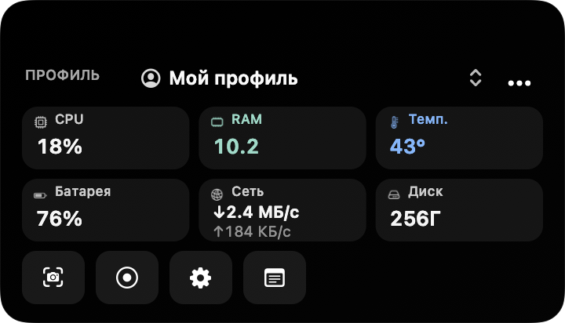

Индикаторы яркости и громкости заменяют системный HUD после выдачи доступа.
Подключение питания и предупреждения показываются отдельным свечением.
Ниже — крупные планы индикаторов и анимация яркости:

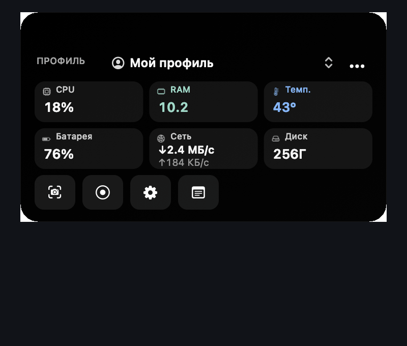

| Работа | Видео | Запись |
|---|---|---|
| 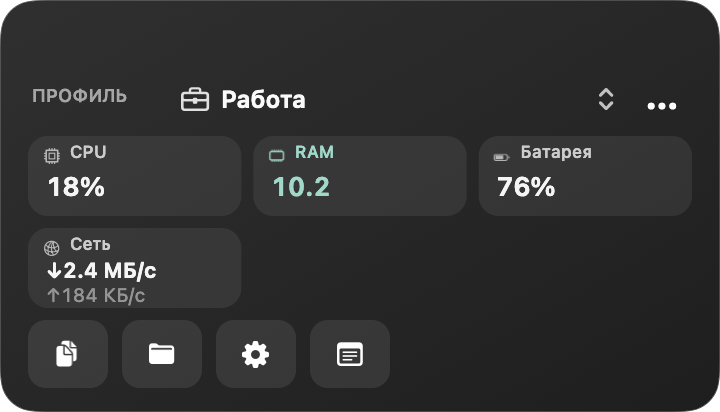 | 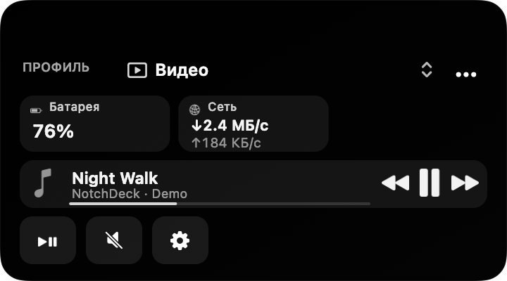 | 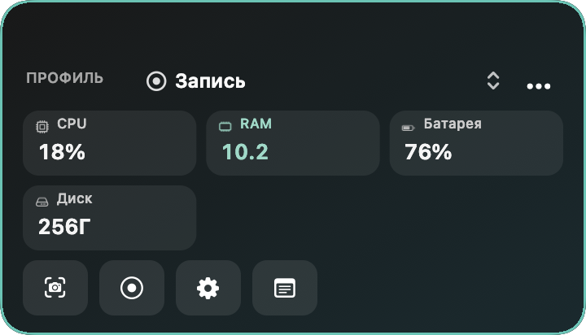 |

**Неон яркости**

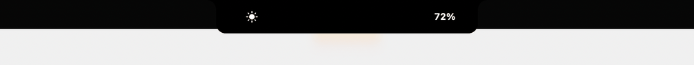

**Неон громкости**

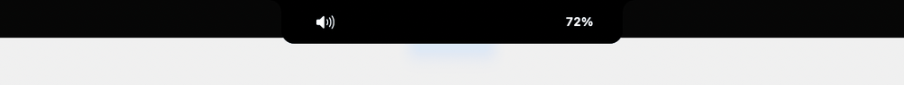

**Подключение питания**

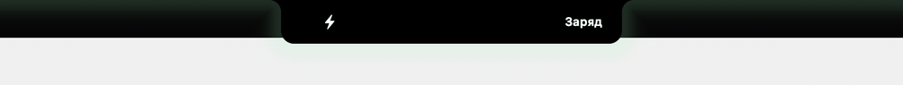

| Индикатор яркости | Индикатор громкости |
|---|---|
| 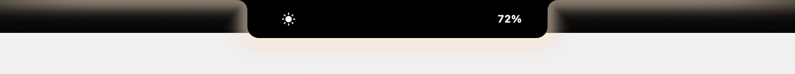 |  |
| **Предупреждение о памяти** | **Импульс при подключении питания** |
|  | 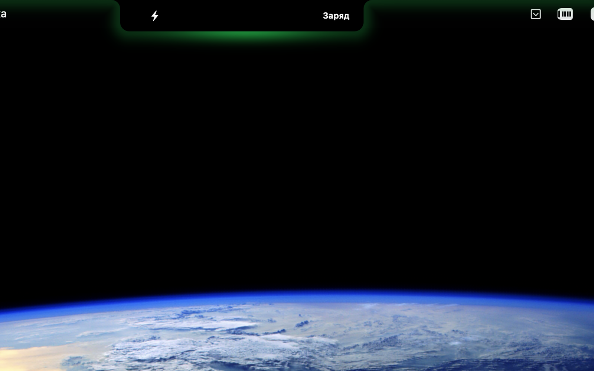 |

<details>
<summary>Настройки → Дизайн — содержимое вкладки</summary>

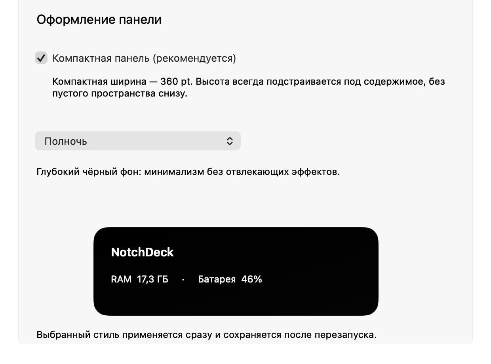

</details>

<details>
<summary>Первый запуск — окно целиком</summary>

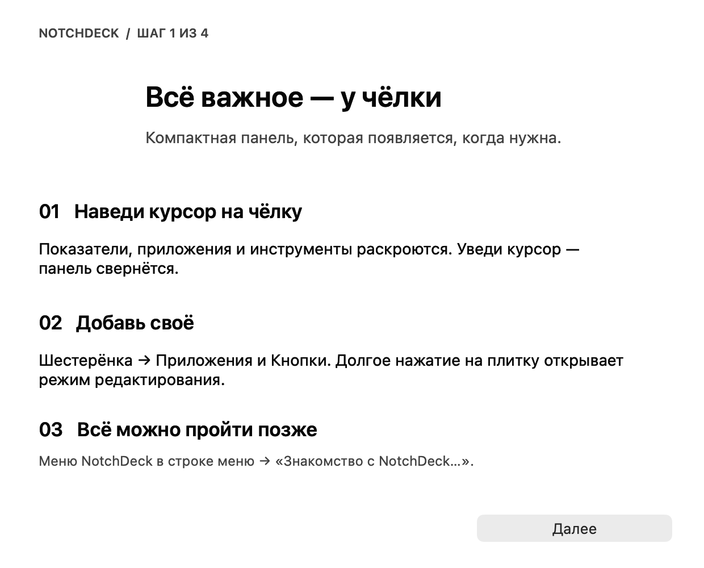

</details>

## Как пользоваться

| Действие | Что сделать |
|---|---|
| Открыть панель | Навести курсор на чёлку; запасной путь — значок NotchDeck в строке меню |
| Добавить приложение | Шестерёнка → Приложения → Добавить приложение |
| Изменить кнопки и дизайн | Шестерёнка → Кнопки / Дизайн |
| Быстро отредактировать | Долгое нажатие на плитку → скрыть / вернуть → Готово |
| Записать экран | Запись → выбрать звук и область → Начать; красная кнопка с таймером останавливает |
| Найти запись | Папка из настроек → вкладка «Запись» (по умолчанию Рабочий стол → Screenshots) |
| Проверить анимации | Меню NotchDeck → Быстрый тест чёлки; тест зарядки — Настройки → Поведение |
| Повторить онбординг | Меню NotchDeck → Знакомство с NotchDeck |

Подробнее: [первый запуск и разрешения](docs/GETTING_STARTED.ru.md).

## Сборка из исходников

Нужны Mac с Apple Silicon, macOS 14 или новее и Xcode Command Line Tools с SDK macOS 26+.

```bash
git clone https://github.com/systemAdmin-ai/NotchDeck.git
cd NotchDeck
./build.sh
open Build/NotchDeck.app
```

Для установки скопируй приложение из `Build` в `Applications`.
Необходимая сторонняя библиотека включена исходниками; зависимости не скачиваются во время сборки.

Один раз создай локальный сертификат подписи — `./scripts/setup-signing.sh`.
Зачем и что он делает: раздел «Если собираешь сам» в установке выше и
[спека](specs/2026-11-18-локальный-сертификат-для-любого-мака.md).

```bash
./scripts/check.sh       # Проверки модели, клавиш и HUD
./scripts/package.sh     # DMG, ZIP приложения и SHA256SUMS в Dist
```

## Ограничения

Температура и управление яркостью могут зависеть от модели Mac. Метаданные
плееров и VPN-статусы зависят от установленных приложений. Для медиа используется
частный API macOS через mediaremote-adapter; поведение может измениться после
обновления ОС. Перенос чужих значков из строки меню не выполняется: NotchDeck
показывает собственные статусы, а системные значки пользователь настраивает в macOS.

## Участие и лицензия

[Сообщить об ошибке](https://github.com/systemAdmin-ai/NotchDeck/issues/new) — укажи
версию приложения, macOS и шаги воспроизведения. Удаляй личные данные со скриншотов.
PR приветствуются. Основной код — [MIT](LICENSE); сторонние компоненты —
[Third-party notices](THIRD_PARTY_NOTICES.md).
